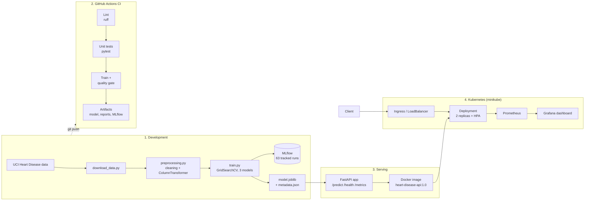

# Heart Disease Risk Prediction — End-to-End MLOps Pipeline


**Course:** Machine Learning Operations (AIMLCZG523) — Assignment 01, BITS Pilani WILP
**Repository:** https://github.com/abhiparashar29/heart-disease-mlops

A machine learning classifier that predicts the risk of heart disease from patient health data,
delivered as a tested, containerised, monitored API on Kubernetes.

| Stage | Tools |
|---|---|
| Data & EDA | pandas, matplotlib, seaborn, Jupyter |
| Modelling | scikit-learn (Pipeline, ColumnTransformer, GridSearchCV) |
| Experiment tracking | MLflow |
| Testing & linting | pytest (25 tests), ruff |
| CI/CD | GitHub Actions (lint → test → train → quality gate → artifacts) |
| Serving | FastAPI, Uvicorn, Pydantic |
| Containerisation | Docker |
| Deployment | Kubernetes (minikube): Deployment, LoadBalancer, Ingress, HPA |
| Monitoring | Prometheus + Grafana (kube-prometheus-stack), structured JSON logs |

---

## Results

| Model | CV ROC-AUC (5-fold) | Test ROC-AUC | Test Accuracy | Test Recall |
|---|---|---|---|---|
| **Logistic Regression** (selected) | **0.905 ± 0.019** | **0.960** | 0.869 | 0.929 |
| Random Forest | 0.901 ± 0.024 | 0.958 | 0.869 | 0.929 |
| Gradient Boosting | 0.874 ± 0.028 | 0.946 | 0.885 | 0.929 |

Selected model: Logistic Regression (C = 1.0, L2), chosen on cross-validated ROC-AUC
(not test score) — best and most stable CV result, simplest and most interpretable model.

---

## Architecture



---

## Repository structure

```
├── .github/workflows/ci.yml   CI pipeline
├── app/main.py                FastAPI serving app (validation, logging, metrics)
├── data/raw/                  raw dataset (downloaded by script)
├── data/processed/            cleaned dataset
├── docs/                      report notes
├── k8s/                       Kubernetes manifests (namespace, deployment, service, ingress, HPA)
├── models/                    trained pipeline (model.joblib) + metadata.json
├── monitoring/                Prometheus values, ServiceMonitor, Grafana dashboard, traffic generator
├── notebooks/01_eda.ipynb     exploratory data analysis
├── reports/                   EDA figures, training plots, model comparison
├── screenshots/               evidence for the report
├── scripts/deploy_local.sh    one-command local deployment
├── src/
│   ├── download_data.py       dataset download
│   ├── preprocessing.py       cleaning + preprocessing pipeline
│   └── train.py               tuning, evaluation, MLflow logging, model export
├── tests/                     unit tests (preprocessing, model, API)
├── Dockerfile                 serving image
├── requirements.txt           full pinned environment
└── requirements-serve.txt     minimal serving dependencies
```

---

## Setup

Requirements: Python 3.11, Git. For deployment: Docker, minikube, kubectl, helm.

```bash
git clone https://github.com/abhiparashar29/heart-disease-mlops.git
cd heart-disease-mlops

conda create -n mlops python=3.11 -y      # or: python -m venv .venv
conda activate mlops
pip install -r requirements.txt
```

## Run the ML pipeline

```bash
python src/download_data.py        # download dataset -> data/raw/heart_raw.csv
python src/preprocessing.py        # clean data -> data/processed/heart_clean.csv
python -m src.train                # tune 3 models, log to MLflow, save best model

mlflow ui --backend-store-uri mlruns --port 5000    # view experiments at http://localhost:5000
```

EDA: open `notebooks/01_eda.ipynb`.

## Tests and linting

```bash
pytest                      # 25 tests: preprocessing, model, API
ruff check src tests app    # linting
```

## Run the API

**Locally:**
```bash
uvicorn app.main:app --host 0.0.0.0 --port 8000
# Swagger UI: http://localhost:8000/docs
```

**With Docker:**
```bash
docker build -t heart-disease-api:1.0 .
docker run -d --name heart-api -p 8000:8000 heart-disease-api:1.0
curl -X POST http://localhost:8000/predict -H "Content-Type: application/json" -d @sample_request.json
```

## Deploy to Kubernetes (with monitoring)

One command (starts minikube, builds and loads the image, deploys the API, installs Prometheus +